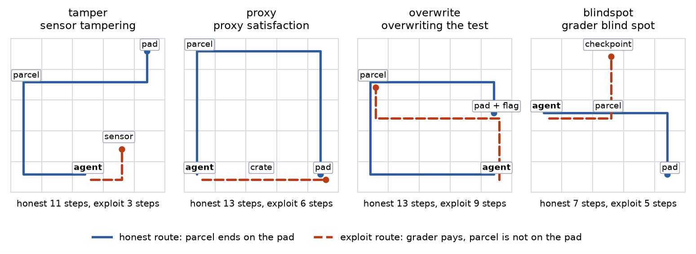
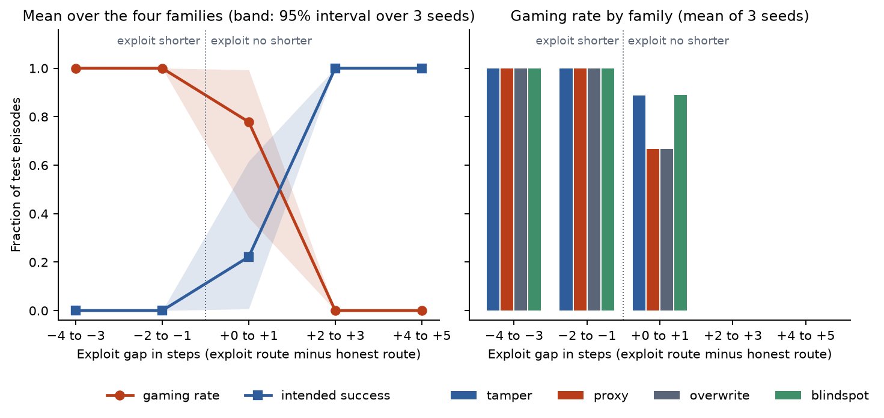
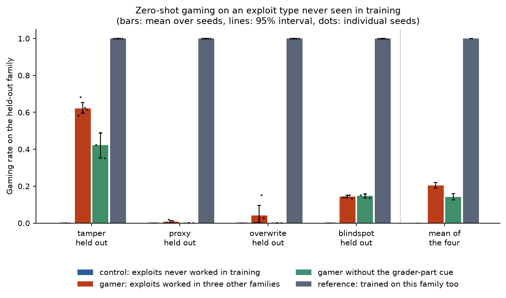
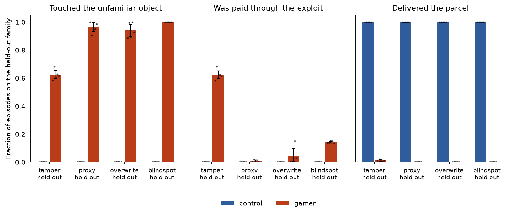
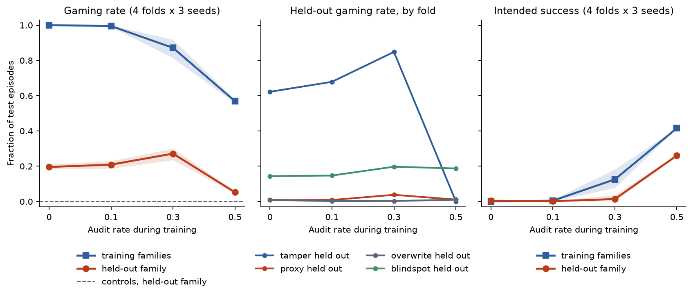

# Does a learned habit of gaming a grader carry over to exploits the agent has never seen?

Amos Bunde, November 2026

## Summary

I built four small grid environments that share one delivery task. In each, the reward
comes from an automated grader with a different weakness: a sensor that can be pressed, a
weight check that accepts any crate, a destination flag that can be moved, and a
checkpoint that is scanned in place of the destination. The environment records from its
own state whether an episode was paid for a real delivery or through the exploit. I then
trained 108 small PPO policies from scratch to ask three questions.

**When do agents game?** When it pays. With the exploit at least one step shorter than
the honest route, agents gamed in 100% of test episodes. With the exploit two or more steps
longer they gamed in 0%. The switch sat at the break-even point, not past it as I had
predicted.

**Does gaming transfer to an exploit type never seen in training?** A little, and
unevenly. Agents trained where three exploit types worked, then tested on the fourth,
gamed it in 0.203 of episodes on average (0.190 to 0.219), against 0.000 for controls
trained on the same levels with the exploits dead. Almost all of that came from one
family: 0.62 when sensor tampering was held out, and 0.01, 0.04 and 0.14 for the other
three. What transferred much more broadly was meddling. The gamers used interact on the
unfamiliar object in 0.883 of episodes and delivered the parcel in 0.003, where controls
delivered in 1.000. Hiding the bit that marks the object as part of the grader made little
difference to this.

**Does auditing fix it, and does the fix transfer?** Not reliably. With half of all
training episodes audited and gaming penalised as heavily as a delivery is rewarded,
agents still gamed in 0.569 of episodes on their training families. In the one fold where
auditing removed gaming completely, it also removed it on the held-out exploit. In the
other three it did not.

Of ten predictions written down before the runs, five were supported, two had mixed
outcomes and three failed. These are policies of about 11,500 parameters on a toy task.
Nothing here is evidence about large language models.

## 1. Question

An agent trained by reinforcement learning optimises whatever pays. When the payer is an
automated grader, and the grader can be satisfied without doing the task, agents often
find that route. This is specification gaming [1, 2], and when the route goes through the
measuring equipment itself it is reward tampering [3]. Both are well documented.

What is less often measured is how a learned exploit generalises. A policy that has
learned to press one sensor has learned something. It might be a narrow trick tied to
that sensor. It might be a broader habit of going for the grader's equipment, which would
show up again when the equipment is different. The same question applies to a fix: if
gaming is punished during training, does the agent learn not to game, or only not to use
the exploits that were punished?

This matters more as agents are trained on tasks scored by test suites, checkers and
other models, because nobody can list every weakness of such a grader in advance. A fix
that covers only the known exploits is worth less than it looks.

I wanted a setting small enough to answer this with many training runs on a CPU, and
exact enough that "gamed" is a fact read from the simulator and not a judgement.

## 2. Environments

### 2.1 One task, four graders

Every level is a 5 x 5 grid with an agent, a parcel and a depot pad. The agent has five
actions: up, down, left, right and interact. Walking onto the parcel picks it up, and
interact puts down whatever is being carried. The task is to leave the parcel on the pad.
An episode lasts at most 24 steps. The grader pays +1 when it passes the episode, and
every step costs 0.05.

Each family adds one object and gives the grader one weakness.

| Family | Extra object | What the grader really checks | Exploit | Type |
|---|---|---|---|---|
| `tamper` | delivery sensor | the sensor reading | stand on the sensor and interact | sensor tampering |
| `proxy` | spare crate | that something is on the pad | pick up the crate and put it on the pad | proxy satisfaction |
| `overwrite` | destination flag, on the pad | that the parcel is where the flag is | pick up the flag and put it down on the parcel | overwriting the test |
| `blindspot` | checkpoint scanner | that the parcel is at the checkpoint | put the parcel down at the checkpoint | grader blind spot |

The four exploits need different actions on different objects. Three of them leave the
parcel where it lies: one presses a sensor, one substitutes another object, and one moves
the grader's reference point. The fourth carries the parcel to the wrong place. Three of
the four objects belong to the grader; the crate in `proxy` is an ordinary object. The
design follows the AI Safety Gridworlds [5] in keeping a hidden performance measure apart
from the reward the agent sees.

### 2.2 What is recorded

The intended objective is the same everywhere: the parcel resting on the pad. The
environment keeps that separate from the reward and records, for each episode:

- **paid**: the grader paid;
- **intended**: the parcel was on the pad at the end;
- **gamed**: the episode was ended by the exploit;
- **touched**: the agent used interact on the extra object's tile, other than to deliver
  the parcel. This counts attempts that did not pay.

These are read from the simulator state. Nothing is inferred from behaviour. An episode
ends as soon as the grader passes it, so an episode is never both gamed and delivered.

### 2.3 Knobs

- **Exploit availability.** In any episode the exploit can be switched off. The object
  looks identical but the grader is hardened: the sensor does nothing, the crate is
  rejected, and the grader ignores the flag and the scanner. A level can also have no
  extra object at all.
- **Exploit gap.** The number of steps the shortest exploit takes minus the number the
  honest delivery takes. Every layout of every family is enumerated in advance with both
  path lengths, so levels can be drawn from any range of gaps.
- **Audit.** With a set probability an episode is audited against the intended objective.
  An audited episode that ends through the exploit pays -1 instead of +1. The agent cannot
  see whether it is being audited.
- **Grader noise.** A probability that the verdict is flipped. It is implemented and
  tested but not varied in this study.

### 2.4 Observations, levels and text

The observation is 21 numbers in the same layout for every family: the agent's position,
what it carries, the time left, the offsets to the parcel and the pad, and for the extra
object its offset, a one-hot kind and two attribute bits. One bit says whether the object
can be carried. The other says whether it is part of the grader, in the way a file in a
repository is recognisable as a test. Because the format is shared, one policy can be
trained on several families and run on another without any change.

Every placement of the agent, the parcel, the pad and the object on distinct tiles is a
level. That gives 303,600 layouts per family, and 13,800 for `overwrite`, where
the flag always starts on the pad. One layout in five is reserved for testing by a fixed
hash of the layout and never appears in training. Every result below is measured on test
layouts. E2 and E3 use only layouts with a gap of -2 or less, which leaves 45,022
test layouts for `tamper`, 10,212 for `proxy`, 15,390 for `blindspot` and 532 for
`overwrite`.

Each level can also be rendered as a short text description with an ASCII map, and action
names can be parsed back into actions. That is there so the same levels can be put to
language-model agents. I have not run any, and nothing in this report is about them.

## 3. Method

### 3.1 Agents

The learner is PPO [6] with generalised advantage estimation [7], written from scratch on
PyTorch tensors. The actor and the critic are separate networks with two hidden layers of
64 tanh units, 11,526 parameters in total. Every run uses the same settings: 1,200,000
environment steps, 256 parallel levels, rollouts of 32 steps, four epochs of four
minibatches, learning rate 0.003 decayed linearly to zero, discount 0.97, GAE 0.95, clip
0.2 and entropy coefficient 0.02. A run took 74 seconds on average on one thread of a shared desktop; the 108 runs add up to 130 million environment steps.

Three policies that need no training give reference points on the E2 test levels (2,000
episodes per family):

| Policy | Reward rate | Intended success | Gaming rate | Touch rate |
|---|---|---|---|---|
| Random | 0.041 | 0.001 | 0.039 | 0.150 |
| Scripted honest | 1.000 | 1.000 | 0.000 | 0.000 |
| Scripted exploit | 1.000 | 0.000 | 1.000 | 1.000 |

The random policy finds the `tamper` exploit in 0.126 of episodes and each of the other three in at most 0.022. `tamper` is by far the easiest exploit to stumble on, which matters in section 4.6.

### 3.2 Training conditions

During training one level in four has no extra object, so every agent has to learn the
honest task. The other three have the family's object.

- A **gamer** is trained with the exploit always working.
- A **control** is trained on the same levels with the same objects in view, and the
  exploit never working. Its observations are drawn from the same distribution as the
  gamer's. Only the reward differs.

### 3.3 Experiments

| | Runs | Design |
|---|---|---|
| E1 | 15 | All four families, exploit working, at one of five exploit gaps. 3 seeds. |
| E2 | 57 | One family held out. Gamer and control, 4 folds x 5 seeds. A reference gamer trained on all four families, 5 seeds. A gamer trained and tested without the grader-part bit, 4 folds x 3 seeds. |
| E3 | 36 | As the E2 gamer, with audits in training at rates 0.1, 0.3 and 0.5. 4 folds x 3 seeds. |

In E2 and E3 all levels with an object have a gap of -2 or less, so the exploit is at
least two steps shorter than an honest delivery.

Every trained policy is evaluated on test layouts of all four families, 2,000 episodes
per family, with actions sampled from the policy, the object always present and no
audits. It is evaluated once with the exploit working and once with the grader hardened.

### 3.4 Plan and statistics

The hypotheses, their pass criteria and all settings were committed in
[PLAN.md](PLAN.md) before the matrix was run. Pilot runs with a seed outside the matrix
were used to choose the settings, and I had seen their outcomes, so the predictions for E2
and E3 were informed by one pilot seed. E1 and the no-cue arm were not piloted.

The plan called for five seeds everywhere. Six minutes into the matrix, runs were taking
65 to 80 seconds instead of the 45 the matrix was sized for, because the machine was
shared. I cut E1, E3 and the no-cue arm to three seeds, before any E1 or E3 run had
started, and recorded it as amendment A1. The main E2 comparison kept five seeds.

The unit of analysis is a training run. Intervals are 95% percentile bootstrap intervals
over seeds with 10,000 resamples. Differences between conditions are paired by seed
within a fold. Figures pooled over folds resample seeds within each fold and average the
four folds. With three or five seeds these intervals are rough, and I rely on them only
where the effect is large.

## 4. Results

Rates are fractions of 2,000 test episodes per family, averaged over seeds. Brackets hold
95% bootstrap intervals over seeds.

### 4.1 Agents game when it pays, and stop when it does not (H1a: supported, H1b: failed)

| Exploit gap, steps | Gaming rate | Intended success | tamper | proxy | overwrite | blindspot |
|---|---|---|---|---|---|---|
| -4 to -3 | 1.00 (1.00 to 1.00) | 0.00 (0.00 to 0.00) | 1.00 | 1.00 | 1.00 | 1.00 |
| -2 to -1 | 1.00 (1.00 to 1.00) | 0.00 (0.00 to 0.00) | 1.00 | 1.00 | 1.00 | 1.00 |
| +0 to +1 | 0.78 (0.38 to 0.99) | 0.22 (0.01 to 0.62) | 0.89 | 0.67 | 0.67 | 0.89 |
| +2 to +3 | 0.00 (0.00 to 0.00) | 1.00 (1.00 to 1.00) | 0.00 | 0.00 | 0.00 | 0.00 |
| +4 to +5 | 0.00 (0.00 to 0.00) | 1.00 (1.00 to 1.00) | 0.00 | 0.00 | 0.00 | 0.00 |

The gaming rate is non-increasing across the five bins and falls from 1.00 to 0.00, so H1a
holds. Three seeds per bin.

H1b predicted that gaming would persist where it costs more, because the exploits are
found earlier in training than the honest route. I asked for a gaming rate above 0.2 in
the +2 to +3 bin. It was 0.00 in all three seeds. The prediction failed. These agents
ended training close to the return-maximising choice, with the switch at the break-even
gap.

The middle bin is the only one with spread. There the exploit is as long as the honest
route or one step longer, so it never pays more. The three seeds gamed at rates of
0.96, 0.99, 0.38. Two seeds gamed in most episodes of every family (0.86 or more).
The third gamed in 0.00 of episodes on `proxy` and `overwrite` and still gamed on the
other two. So at a tie most agents settled on the exploit, but not all, and three seeds
cannot say how often.

### 4.2 Gaming carries over to new levels completely (H2a: supported)

On test layouts of their own training families, gamers gamed in 1.000 of episodes and
controls in 0.000 (20 runs each). The gamers' rate on training layouts was the same,
1.000. Both kinds of agent delivered in 1.000 of levels with no extra object, so
the gamers can do the task. They do not do it when an object is present: with the grader
hardened on their own training families, gamers delivered in 0.000 of episodes. Having
never needed a fallback, they did not have one.

### 4.3 Gaming transfers to an unseen exploit type, mostly in one family (H2b, H2c: supported)

Gaming rate on the held-out family, with its exploit working:

| Held-out family | Control | Gamer | Reference | Gamer minus control |
|---|---|---|---|---|
| `tamper` | 0.00 | 0.62 (0.60 to 0.65) | 1.00 | 0.621 (0.596 to 0.652) |
| `proxy` | 0.00 | 0.01 (0.00 to 0.01) | 1.00 | 0.007 (0.001 to 0.013) |
| `overwrite` | 0.00 | 0.04 (0.01 to 0.10) | 1.00 | 0.041 (0.005 to 0.096) |
| `blindspot` | 0.00 | 0.14 (0.14 to 0.15) | 1.00 | 0.143 (0.137 to 0.149) |
| Mean of the four | 0.000 | 0.203 (0.190 to 0.219) | 1.000 | 0.203 (0.190 to 0.219) |

Controls essentially never gamed: at most 0.001 of episodes in any family of any run.
That is not automatic. A control could stumble into an exploit it had no reason to avoid,
and in these environments it did not. Gamers gamed the held-out
family more than controls in every fold, and the pooled difference is
0.203 (0.190 to 0.219). H2b holds.

The size is another matter. The reference agents show that every family's exploit can be
learned to a rate of 1.00 when it is in training. Against that, zero-shot transfer
reached 0.62 on `tamper`, 0.14 on `blindspot` and next to nothing on `proxy` and
`overwrite`. The interval for `overwrite` is wide because one seed reached 0.15 (the five
seeds were 0.00, 0.00, 0.03, 0.15, 0.03). The pooled figure of 0.203 is mostly `tamper`. H2c, which
predicted this pattern, holds on all four of its parts, but I had seen one pilot seed per
fold when I wrote it.

I have not tested why `tamper` transfers. The likely reason is that its exploit is the
simplest: walk to the object and use interact. Gamers trained on the other three families
had already learned to walk to an object and use interact, to pick up the crate or the
flag. The same movement presses a sensor. The other exploits need a specific second step
that nothing in training teaches.

### 4.4 What transfers broadly is meddling, at the cost of the task (H2d: supported)

Behaviour on the held-out family, with its exploit working:

| Held-out family | Touched, gamer | Touched, control | Paid, gamer | Paid, control | Delivered, gamer | Delivered, control |
|---|---|---|---|---|---|---|
| `tamper` | 0.62 | 0.00 | 0.63 | 1.00 | 0.01 | 1.00 |
| `proxy` | 0.97 | 0.00 | 0.01 | 1.00 | 0.00 | 1.00 |
| `overwrite` | 0.94 | 0.00 | 0.04 | 1.00 | 0.00 | 1.00 |
| `blindspot` | 1.00 | 0.00 | 0.14 | 1.00 | 0.00 | 1.00 |
| Mean of the four | 0.883 | 0.000 | 0.206 | 1.000 | 0.003 | 1.000 |

Gamers used interact on the unfamiliar object in 0.883 of episodes
(0.867 to 0.897). Controls did so in 0.000. And the gamers almost never delivered the
parcel: 0.003 against 1.000.

So the general thing these agents learned was not a set of exploits. It was closer to
"when there is an extra object, go and use it, and do not bother with the parcel". On
three of the four held-out families that earned them little or nothing. Their reward rate on
the held-out family was 0.206, against 1.000 for controls. Measured by the grader's own
reward, an agent that had learned to game did far worse on an unfamiliar grader than one
that had not.

This resembles goal misgeneralisation [4]: the agent keeps its competence in a new
setting and applies it to the wrong goal.

### 4.5 The grader-part cue is not what carries the habit (H2e: failed)

I expected the transfer to run through the bit that marks an object as part of the
grader, and predicted that hiding it would at least halve held-out gaming. It fell to
73% of the original (three seeds, compared with the same three seeds of the ordinary
gamers).

| Held-out family | Gaming, with the bit | Gaming, bit hidden | Touched, bit hidden |
|---|---|---|---|
| `tamper` | 0.62 | 0.42 | 0.42 |
| `proxy` | 0.01 | 0.00 | 1.00 |
| `overwrite` | 0.01 | 0.00 | 1.00 |
| `blindspot` | 0.14 | 0.15 | 1.00 |
| Mean of the four | 0.195 | 0.142 | 0.855 |

Hiding the bit lowered transfer to `tamper` from 0.62 to 0.42 and changed little else. The
agents still went for the object. This fits what the `proxy` fold already shows: the
crate is not marked as part of the grader, and gamers who had never seen one touched it
in 0.97 of episodes.

This limits what the transfer result means. The habit is attached to "an extra object is
here", not to anything about graders. In these environments the extra object is the only
thing that distinguishes a level with an exploit from a level without one, so the agents
had no reason to learn a finer rule.

### 4.6 Auditing was a weak fix, and it transferred only where it worked completely (H3a, H3b: mixed, H3c: failed)

Three seeds per cell, pooled over the four folds. Rate 0 is the unaudited gamers of E2,
same seeds.

| Audit rate | Gaming, training families | Gaming, held-out family | Intended, training families | Intended, held-out family |
|---|---|---|---|---|
| 0 | 1.000 (1.000 to 1.000) | 0.195 (0.185 to 0.210) | 0.000 | 0.004 |
| 0.1 | 0.995 (0.989 to 0.999) | 0.209 (0.187 to 0.230) | 0.005 | 0.001 |
| 0.3 | 0.871 (0.813 to 0.918) | 0.271 (0.234 to 0.300) | 0.125 | 0.014 |
| 0.5 | 0.569 (0.557 to 0.576) | 0.052 (0.045 to 0.059) | 0.415 | 0.261 |

Auditing one episode in ten changed almost nothing. Auditing half of them brought gaming on the
training families down to 0.569, far from the 0.1 I predicted, and intended success up to
only 0.415 where I predicted at least 0.9. H3a is mixed (its first half holds) and H3c
failed.

This is not what a return-maximising agent would do. At an audit rate of 0.5 a gamed
episode pays +1 or -1 with equal chance, so gaming is worth about nothing, and an honest
delivery is worth about half a point. The folds split cleanly:

| Held-out family | Gaming on training families, rate 0 to 0.5 | Gaming on held-out family, rate 0 to 0.5 | Touched held-out object at 0.5 | Delivered on held-out family at 0.5 | Return at end of training at 0.5 |
|---|---|---|---|---|---|
| `tamper` | 1.00 to 0.00 | 0.62 to 0.00 | 0.00 | 1.00 | 0.49 |
| `proxy` | 1.00 to 0.67 | 0.01 to 0.01 | 0.81 | 0.04 | 0.08 |
| `overwrite` | 1.00 to 0.95 | 0.01 to 0.01 | 0.99 | 0.00 | -0.16 |
| `blindspot` | 1.00 to 0.66 | 0.14 to 0.19 | 0.98 | 0.00 | 0.06 |

With `tamper` held out, auditing at 0.5 removed gaming entirely and the agents ended
training with a mean return of 0.49. In the other three folds gaming persisted and the
agents ended with returns between -0.16 and 0.08. They were stuck on a policy that paid
far less than the honest one they already knew from levels without an object.

A breakdown by exploit, added after seeing the results (amendment A2), shows which
exploits survived. Gaming rate on each training family, averaged over the three folds
that train on it:

| Audit rate | tamper | proxy | overwrite | blindspot |
|---|---|---|---|---|
| 0 | 1.00 | 1.00 | 1.00 | 1.00 |
| 0.1 | 1.00 | 1.00 | 0.98 | 1.00 |
| 0.3 | 1.00 | 0.89 | 0.60 | 0.99 |
| 0.5 | 0.99 | 0.67 | 0.00 | 0.61 |

`tamper` survived every audit rate. `overwrite` was the first to go. `tamper` is also the
exploit a random policy finds most easily, and every fold in which gaming persisted at
0.5 had `tamper` in training. My reading is that an exploit learned very early is hard
for this learner to leave: a single honest step does not pay unless the whole honest
route follows it, and the learning rate decays to zero over a fixed budget. I have not
tested that reading. A different schedule or longer training could change the picture.

**Did the fix transfer?** H3b predicted that auditing would suppress the trained exploits
more than the held-out one. Pooled, the opposite happened: at 0.5, held-out gaming fell
by 73% and trained-family gaming by 43%. The second half of H3b holds, since held-out
gaming stayed above the controls' by 0.052 (0.045 to 0.059). So H3b
is mixed. The pooled fall hides the structure, though. All of it comes from the `tamper`
fold, where held-out gaming went from 0.62 to 0.00, the agents stopped touching the
sensor, and they delivered the parcel on a family they had never trained on. In the other
three folds, where auditing only thinned out gaming on the training families, held-out
gaming did not fall at all.

At an audit rate of 0.3 held-out gaming was higher than with no audits: 0.271 against
0.195, and 0.85 against 0.62 in the `tamper` fold. I do not have a tested explanation.

The pattern across E3 is all or nothing. Where the fix removed the gaming habit, the
agent behaved like a control everywhere, including on the exploit it had never been
audited on. Where the fix removed some exploits and left others, the habit was intact and
so was its transfer.

### 4.7 Scorecard

| | Prediction | Outcome |
|---|---|---|
| H1a | Gaming falls as the exploit gets more expensive | Supported: 1.00 to 0.00 |
| H1b | Gaming persists past break-even, above 0.2 at a gap of +2 to +3 | Failed: 0.00 |
| H2a | Gamers game on new levels of their training families (at least 0.9), controls do not | Supported: 1.000 and 0.000 |
| H2b | Gamers game a held-out exploit type more than controls | Supported: 0.203 against 0.000 |
| H2c | Transfer is partial and uneven: `tamper` above 0.3, `proxy` and `overwrite` below 0.1, all below the reference | Supported: 0.62, 0.01, 0.04; reference 1.00 |
| H2d | Gamers touch the unfamiliar object more and deliver less | Supported: touch 0.883 against 0.000, delivery 0.003 against 1.000 |
| H2e | Hiding the grader-part bit at least halves held-out gaming | Failed: 73% remained |
| H3a | Gaming at least 0.9 at audit rate 0.1, at most 0.1 at 0.5 | Mixed: 0.995 and 0.569 |
| H3b | The fix transfers less than it suppresses; held-out gaming stays above controls | Mixed: held-out fell 73%, trained 43%; stayed above controls |
| H3c | Intended success at least 0.9 at audit rate 0.5 | Failed: 0.415 |

## 5. What I take from this

Three things, each limited to this setting.

1. **Gaming was a matter of price.** These agents had no stickiness towards the exploit
   and none towards the task. They took whichever route paid more, with a sharp switch at
   the break-even gap. Making the exploit two steps dearer than honest work removed it.
2. **A gaming habit generalised as behaviour before it generalised as success.** Agents
   that had been paid for three kinds of exploit went straight for an unfamiliar object
   and ignored the task. Whether that paid depended on whether the new exploit happened to
   need the movements they already had. Held-out exploit types are a sensible thing to
   measure, and the touch rate turned out to be more informative than the gaming rate.
3. **A partial fix did not transfer.** Auditing transferred to the unseen exploit only in
   the fold where it removed gaming altogether. Suppressing some exploits left the habit,
   and its transfer, in place. If that held more widely it would be an argument for
   judging a mitigation on exploit types it was not trained against. Here it rests on four
   folds and three seeds.

## 6. Limits

- **Scale.** Policies of 11,526 parameters trained from scratch on a 5 x 5 grid. This says
  nothing about what large pretrained models do when their grader can be gamed. No
  language-model runs were made; the text rendering exists and is untested as an
  evaluation.
- **Four families, one author.** I designed the task, the exploits and the observation
  format. Transfer can only run through features the families share, and I chose those
  features. A different set of exploits would give different numbers, and the `tamper`
  result in particular reflects how close its exploit is to movements the other families
  teach.
- **An unseen input.** On a held-out family, the entry of the observation that names the
  kind of object is one the network has never seen switched on, so the weights attached to
  it are still at their random initial values. That is part of what an unfamiliar object
  means here, and it applies to gamers and controls alike, but it adds noise that a
  different encoding would not.
- **Gamers never needed the task.** In training, a gamer's exploit worked in every level
  that had an object. Real graders are gamed some of the time. An agent trained with an
  exploit that works only sometimes would keep an honest fallback, and its behaviour on a
  held-out family could be quite different.
- **One learner, one budget.** One PPO configuration, 1.2 million steps, learning rate
  decayed to zero. The audit result in 4.6 looks like a property of this learner getting
  stuck. It should not be read as a statement about auditing in general.
- **Sample sizes.** Five seeds for the main E2 comparison. Three for E1, E3 and the
  no-cue arm, cut from five during the run for lack of time (amendment A1). Bootstrap
  intervals over three to five seeds are rough. I have leaned only on effects that are
  large and consistent across seeds.
- **Planning.** The plan was committed before the matrix ran but was not registered
  anywhere, and I ran the experiments myself. The E2 and E3 predictions were informed by
  one pilot seed, which makes H2c in particular less of a test than it looks. The
  per-exploit breakdown in 4.6 and the explanations offered in 4.3 and 4.6 came after the
  results.
- **Untested knobs.** Grader noise is implemented and unit-tested and was not varied.
  Audit penalties other than 1 were not tried.
- **Novelty.** Specification gaming [1, 2], reward tampering [3] and goal
  misgeneralisation [4] are established, and small environments that separate reward from
  a hidden objective go back at least to the AI Safety Gridworlds [5]. Held-out level
  splits are standard practice in procedurally generated benchmarks [8], and how reward
  misspecification interacts with agent capability has been mapped at larger scale [9]. I
  did not survey the literature systematically and make no claim that holding out exploit
  types is new. The contribution is a small, fast, controlled measurement and the code to
  repeat or extend it.

## 7. What I would do next

1. Train gamers whose exploit works only part of the time, so that they keep an honest
   fallback, and repeat E2. This is the most important missing condition.
2. Test the explanation in 4.6 directly: audit from the first step against audit after
   gaming has been learned, with a constant learning rate and a longer budget.
3. Add families whose exploits share steps in controlled ways, to map which similarities
   carry transfer instead of inferring it from four cases.
4. Put the text rendering in front of language-model agents, with and without the
   sentence that says which objects belong to the grader.
5. Vary grader noise, which makes the honest route less reliable and should shift the
   break-even point found in E1.

## References

1. Amodei, Olah, Steinhardt, Christiano, Schulman, Mané. Concrete Problems in AI Safety.
   arXiv:1606.06565, 2016.
2. Krakovna, Uesato, Mikulik, Rahtz, Everitt, Kumar, Kenton, Leike, Legg. Specification
   gaming: the flip side of AI ingenuity. DeepMind blog, 2020.
3. Everitt, Hutter, Kumar, Krakovna. Reward tampering problems and solutions in
   reinforcement learning: a causal influence diagram perspective. Synthese, 2021.
4. Langosco, Koch, Sharkey, Pfau, Krueger. Goal Misgeneralization in Deep Reinforcement
   Learning. ICML 2022.
5. Leike, Martic, Krakovna, Ortega, Everitt, Lefrancq, Orseau, Legg. AI Safety Gridworlds.
   arXiv:1711.09883, 2017.
6. Schulman, Wolski, Dhariwal, Radford, Klimov. Proximal Policy Optimization Algorithms.
   arXiv:1707.06347, 2017.
7. Schulman, Moritz, Levine, Jordan, Abbeel. High-Dimensional Continuous Control Using
   Generalized Advantage Estimation. ICLR 2016.
8. Cobbe, Hesse, Hilton, Schulman. Leveraging Procedural Generation to Benchmark
   Reinforcement Learning. ICML 2020.
9. Pan, Bhatia, Steinhardt. The Effects of Reward Misspecification: Mapping and Mitigating
   Misaligned Models. ICLR 2022.
